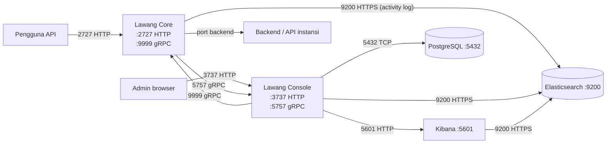

# Lawang — Port & Arah Koneksi

Panah menunjukkan arah koneksi dibuka (dari → ke).

## Diagram

## Detail koneksi

| No | Dari | Ke | Port | Protokol | Untuk apa |
|---:|---|---|---|---|---|
| 1 | Pengguna API (aplikasi OPD / mitra) | Lawang Core | 2727 | HTTP | Trafik API yang dilewatkan gateway |
| 2 | Admin (browser) | Lawang Console | 3737 | HTTP | UI admin + REST API Console; dashboard Kibana juga dibuka lewat sini |
| 3 | Lawang Core | Lawang Console | 5757 | gRPC | Core ambil konfigurasi saat start, otorisasi & potong saldo per request |
| 4 | Lawang Console | Lawang Core | 9999 | gRPC | Deploy endpoint / backend / secret / credential, tes koneksi, jalankan job |
| 5 | Lawang Core | Backend / API instansi | sesuai backend | HTTP / DB | Meneruskan request ke layanan tujuan |
| 6 | Lawang Core | Elasticsearch | 9200 | HTTPS | Kirim activity log |
| 7 | Lawang Console | Elasticsearch | 9200 | HTTPS | Baca hasil request (API integrasi mitra) |
| 8 | Lawang Console | Kibana | 5601 | HTTP | Proxy dashboard Kibana |
| 9 | Lawang Console | PostgreSQL | 5432 | TCP | Database Console (konfigurasi, saldo, audit) |
| 10 | Kibana | Elasticsearch | 9200 | HTTPS | Sumber data dashboard |

## Ringkasan per server

| Server | Inbound | Outbound |
|---|---|---|
| Lawang Core | 2727 (dari pengguna API), 9999 (dari Console) | 5757 ke Console, 9200 ke Elasticsearch, port backend instansi |
| Lawang Console | 3737 (dari admin), 5757 (dari Core) | 9999 ke Core, 5432 ke PostgreSQL, 9200 ke Elasticsearch, 5601 ke Kibana |
| Kibana | 5601 (dari Console) | 9200 ke Elasticsearch |
| Elasticsearch | 9200 (dari Core, Console, Kibana) | – |
| PostgreSQL | 5432 (dari Console) | – |

## Catatan

- Yang perlu dibuka ke pengguna hanya **2727** (API) dan **3737** (admin). Port lain cukup antar-server di jaringan internal.
- **9999** adalah port gRPC default Core di menu Server → Setting; kalau diubah di sana, ikuti nilai itu.